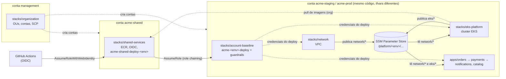

# Acme Platform: IaC de exemplo

Estate Terraform de exemplo de uma empresa grande na AWS, desenhado com as skills do plugin `iac-patterns`
(`skills/*/SKILL.md` na raiz do repositório). O contrato entre stacks, módulos e apps está em
[`ARCHITECTURE.md`](ARCHITECTURE.md); cada diretório tem um `README.md` curto com dono, ambientes, o que lê
e o que publica.

- `stacks/`: plataforma (bootstrap, organization, account-baseline, shared-services, network, eks-platform)
- `apps/`: um stack por app (orders, payments, notifications, catalog), cada um de um time
- `modules/`: módulos de domínio da casa, com testes offline (`mock_provider`)
- `scripts/deploy.sh`, `ci/github-actions.yml`: como tudo é aplicado

## Visão geral



Toda conta tem também o seu `stacks/bootstrap` (bucket de state `acme-tfstate-<env>`), omitido no diagrama.

## Ambientes

| Ambiente | Conta | Stacks | Papel |
|---|---|---|---|
| `management` | management | bootstrap, organization | organização, contas e SCPs |
| `shared` | acme-shared | bootstrap, account-baseline, shared-services | ECR, OIDC do CI, roles de deploy |
| `staging` | acme-staging | bootstrap, account-baseline, network, eks-platform, apps | delivery environment, upstream de prod |
| `prod` | acme-prod | bootstrap, account-baseline, network, eks-platform, apps | produção |

Variação entre ambientes só em `environments/<env>.tfvars` (staging pequeno, prod multi-AZ e robusto).
State: bucket `acme-tfstate-<env>` na própria conta, chave `<caminho-do-stack>/terraform.tfstate`,
lock nativo do S3 (`use_lockfile`).

## Ordem de bootstrap e deploy

Passos 1 a 4 rodam uma vez, por uma pessoa com credencial de admin da conta (`AWS_PROFILE`); do 5 em
diante o CI faz o trabalho.

| # | Stack | Ambiente(s) | Quem roda |
|---|---|---|---|
| 1 | `stacks/bootstrap` | `management` | admin (state local, depois migrado para o bucket) |
| 2 | `stacks/organization` | `management` | admin |
| 3 | `stacks/bootstrap` | `shared`, `staging`, `prod` | admin de cada conta nova (idem) |
| 4 | `stacks/account-baseline` | `shared`, `staging`, `prod` | admin de cada conta |
| 5 | `stacks/shared-services` | `shared` | admin / pipeline próprio |
| 6 | `stacks/network` | `staging`, depois `prod` | CI |
| 7 | `stacks/eks-platform` | `staging`, depois `prod` | CI |
| 8 | `apps/orders` → `apps/payments` → `apps/notifications`, `apps/catalog` | `staging`, depois `prod` | CI |

Depois do passo 2, copie `organization_id` e `account_ids` para os tfvars (`shared-services`,
`account-baseline`) e, depois dos passos 4 e 5, as ARNs das roles para as variáveis dos GitHub environments.
A ordem das apps vem dos tópicos: `payments` assina `orders-events`, `notifications` assina os dois.

### `bootstrap`

Em regime usa o backend `s3` como os outros (`environments/<env>.s3.tfbackend`, chave
`stacks/bootstrap/terraform.tfstate`). Na primeira vez numa conta o bucket ainda não existe: apply com um
`backend_override.tf` local temporário e depois `init -migrate-state`, passo a passo em
[`stacks/bootstrap/README.md`](stacks/bootstrap/README.md).

### Demais stacks: `scripts/deploy.sh`

```bash
scripts/deploy.sh <stack-dir> <env> <plan|apply>

export AWS_PROFILE=acme-staging-admin
scripts/deploy.sh stacks/account-baseline staging plan
scripts/deploy.sh stacks/account-baseline staging apply   # aplica exatamente o <env>.tfplan salvo
```

`plan` faz `init` com `environments/<env>.s3.tfbackend`, grava `<env>.tfplan` e roda o gate de mudança
destrutiva (`scripts/check-plan.sh`): falha se o plano apaga ou substitui qualquer recurso, a não ser com
`ALLOW_DESTROY=true` (override deliberado, só depois de revisar o plano). `apply` aplica só o plano salvo.
O script falha se o stack não tiver tfvars/backend do ambiente. Credenciais vêm do ambiente.
Teste do gate (offline, precisa de `jq`): `scripts/check-plan_test.sh`.

## CI (`ci/github-actions.yml`)

1. **PR e push**: `fmt -check`, `init -backend=false` + `validate` em todo módulo/stack/app, `tflint`,
   `trivy config` (HIGH/CRITICAL falham; exceções aceitas com justificativa em `.trivyignore`),
   `terraform test` dos módulos e `scripts/check-plan_test.sh` (offline, sem credencial).
2. **push na `main`**: detecta stacks alterados (mudança em `modules/` redeploya todas as apps). Para
   **staging**: job de `plan` por stack (plano no summary do job, `<env>.tfplan` + texto como artifact, gate
   `check-plan.sh`), depois job de `apply` que baixa e aplica exatamente aquele plano, um stack por vez na
   ordem de deploy.
3. **production**: o mesmo fluxo com o mesmo `github.sha` e o mesmo lock file (`-lockfile=readonly`). O
   `apply` só roda depois da aprovação no GitHub environment `production`, dada lendo o plano. Como a trust
   OIDC de prod só aceita o environment `production`, o job de `plan` de prod também pede uma aprovação
   (só para planejar); tirar essa exige uma role de plan read-only com environment próprio no `shared-services`.
4. **Deletes/replaces**: o gate bloqueia o plano. Se a remoção é intencional e foi revisada, rode o
   workflow manualmente (`workflow_dispatch` na `main`, `allow_destroy = true`): ele refaz os planos dos
   stacks do último commit com `ALLOW_DESTROY=true`; prod continua exigindo aprovação.

Plan e apply são jobs separados, um stack por job: cada um assume as roles de novo e tem a sua 1 hora de
sessão encadeada.

Credenciais em cada job de deploy (role chaining):
GitHub OIDC → `acme-shared-deploy-<env>` (conta shared, trust presa a repo + GitHub environment) →
`acme-<env>-deploy` (conta alvo, trust presa a essa role por `aws:PrincipalArn`). Variáveis por GitHub
environment: `AWS_DEPLOY_ROLE_ARN` e `AWS_TARGET_ROLE_ARN`. `bootstrap`, `organization`,
`account-baseline` e `shared-services` ficam fora do deploy automático (controle de identidade e da conta).

## Decisões

| Decisão | Skill |
|---|---|
| Uma conta por ambiente; contas como código no `organization`; `shared` fora do caminho de entrega | `environment-design` |
| Staging é upstream de prod, mesmo código; variação só em tfvars | `environment-design` |
| Stacks separados por ciclo de vida e dono (bootstrap, org, baseline, rede, cluster, uma app por time) | `stack-structure` |
| Integration Registry no SSM em vez de `terraform_remote_state`; nomes de parâmetro são API pública | `stack-integration` |
| Tópicos de outra app achados por nome convencionado (`<app>-<env>-events`), Resource Matching | `stack-integration` |
| Configuração por `environments/<env>.tfvars` + backend parcial `.s3.tfbackend` | `stack-configuration` |
| Módulos de domínio da casa sem provider/backend/descoberta; recebem tudo por variável | `stack-modules` |
| Módulos da comunidade fixados (`vpc ~> 6.8`, `eks ~> 21.30`) | `stack-modules` |
| Build once, deploy many: mesmo commit e lock file de staging para prod; `deploy.sh` aplica o plano salvo | `delivery-workflow` |
| Checks offline em todo PR; `terraform test` com `mock_provider` nos módulos | `stack-testing` |
| SCP de baseline, permissions boundary e guardrails de conta (S3 BPA, EBS) como código | `infra-governance` |
| OIDC sem chave longa; trust presa a repo + GitHub environment; aprovação de prod no environment | `infra-governance` |
| `prevent_destroy`/`deletion_protection` em dados e chaves; expand/contract para nomes do registry | `safe-infra-changes` |
| Layout de arquivos, `default_tags`, `use_lockfile`, `~> 6.0`, sem account ID/`assume_role` no stack | `terraform-conventions` |

## Placeholders a trocar

- `organization_id = "o-exampleorg1"` (`stacks/shared-services/environments/shared.tfvars`)
- `github_repository = "acme/platform"` (`stacks/shared-services/environments/shared.tfvars`)
- Account IDs `111111111111` (shared, em `stacks/account-baseline/environments/*.tfvars`),
  `222222222222` (staging) e `333333333333` (prod) (`admin_role_arn` em `stacks/eks-platform/environments/*.tfvars`)
- E-mails `aws+acme-*@example.com` (`stacks/organization/environments/management.tfvars`)
- `kubernetes_version = "1.35"` (`stacks/eks-platform/environments/*.tfvars`): confirmar que a versão
  está disponível no EKS na hora do deploy
- Variáveis dos GitHub environments `staging`/`production`: `AWS_DEPLOY_ROLE_ARN`, `AWS_TARGET_ROLE_ARN`

## Fora do escopo / gaps conhecidos

- **Push no ECR pelo CI**: as roles de deploy só fazem role chaining; build/push de imagem precisa de uma
  role (ou permissão) própria na conta shared.
- **VPC endpoints** (ECR, S3, STS, SSM...): todo tráfego sai pelo NAT.
- **Manifests Kubernetes** das apps (Deployment, ServiceAccount): os stacks criam só os recursos AWS e a
  Pod Identity.
- **Conta de observabilidade/segurança** (logs centralizados, CloudTrail org, Security Hub): não existe.
- **Security Groups for Pods**: RDS/Redis aceitam o SG dos nós do EKS (shortcut documentado em cada app);
  trocar por SG por pod para isolar apps entre si.
- Sessões encadeadas duram no máximo 1 hora por job: um `apply` de EKS mais longo que isso falha no meio.
- Todos os planos de um ambiente rodam antes do primeiro apply: um stack que lê do SSM valores que um stack
  anterior muda no mesmo push é planejado com os valores antigos. Mande mudanças de `network`/`eks-platform`
  separadas das apps (ou rode de novo depois).
